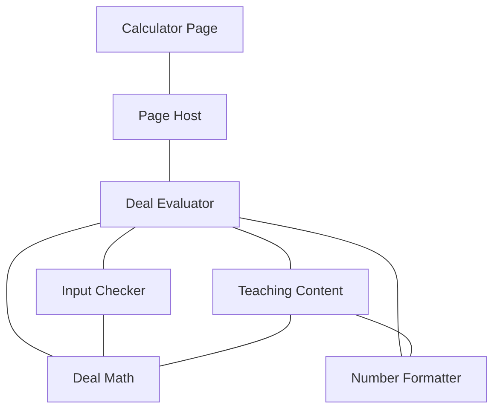

# Deal Calculator Architecture

This is a short guide to how the code is organized, for anyone working on it. It follows the team's Software
Design Specification (SDS, last updated November 17, 2026). Requirement numbers (R1 to R20) refer to the Software
Requirements Specification (SRS). If this file and the SDS disagree, update whichever is wrong so they match.

## What the system does

A member starts the calculator with `python -m dealcalc`, and it prints a status report with the address to open.
On the page, the member types a listing's four numbers. Each time an input changes, the page sends the inputs to
the Python program, which checks them, works out the results, writes the worked formulas and messages, and, in
comparison mode, finds the deltas. The page only displays what the program sends back.

- **Python standard library only.** Nothing to install beyond Python 3.11 or later and a virtual environment.
- **Nothing is saved.** Each answer depends only on the inputs sent with it.
- **This computer only.** The calculator listens on `127.0.0.1`, so no other computer can reach it, and there are
  no accounts or passwords.

## Components

| Component | File | What it does | Owner | SDS |
|---|---|---|---|---|
| Calculator Page | `dealcalc/static/page.html`, `page.css`, `page.js` | The page in the browser: inputs, results, worked formulas, messages, explanations, deltas, mode switch, hide/show explanations, and "try a sample deal". **No math.** | Ben | 4.7 |
| Page Host | `dealcalc/page_host.py` | Starts the calculator, checks it works, prints the status report (R14), sends the page files, and answers the page's requests. | Ben | 4.6 |
| Deal Evaluator | `dealcalc/deal_evaluator.py` | Turns one or two properties' typed inputs into everything the page shows: errors, warnings, results, worked formulas, and deltas. | Alejandro | 4.5 |
| Input Checker | `dealcalc/input_checker.py` | Reads typed text as numbers, checks each input's valid range (R2), and finds unusual values (R3). | Jonny | 4.2 |
| Deal Math | `dealcalc/deal_math.py` | The four formulas (R4) and the deltas (R12). **The only module with formulas.** | Alejandro | 4.1 |
| Teaching Content | `dealcalc/teaching_content.py` | **All the words written for members:** page and section purposes, definitions, where to find each input, the cap rate note, the sample deals, and the worked-formula text (R5 to R9, R13, R17). | Gabe | 4.4 |
| Number Formatter | `dealcalc/number_format.py` | Writes dollars, percents, and signed deltas in the formats in SRS Section 3.1. | Jonny | 4.3 |

`dealcalc/__main__.py` checks the Python version and then calls `page_host.main()`.

## How the components fit together

The components form layers. Each line below means "uses"; nothing uses a component above it.



- The **Calculator Page** uses only the Page Host's HTTP routes.
- The **Page Host** uses only the Deal Evaluator.
- The **Deal Evaluator** is the one component that combines the others.
- The **Input Checker** and **Teaching Content** use the `Deal` and `Results` types from Deal Math, and Teaching
  Content uses the Number Formatter to write its worked formulas.
- **Deal Math** and the **Number Formatter** use no other component.

## Data

The four inputs and four results always use these field names (`deal_math.INPUT_FIELDS` and `RESULT_FIELDS`):

| Inputs | Meaning | Results | Meaning |
|---|---|---|---|
| `price` | purchase price, dollars (more than 0) | `gpr` | gross potential rent, dollars per year |
| `monthly_rent` | rent each month for all units, dollars | `egi` | effective gross income, dollars per year |
| `vacancy_pct` | vacancy rate, percent (5 means 5%) | `noi` | net operating income, dollars per year |
| `operating_costs` | yearly operating costs, dollars | `cap_rate_pct` | cap rate, percent |

- **Raw inputs** are the text a member typed: a dict from field name to string, such as
  `{"price": "1,200,000", ...}`.
- **`Deal`** holds a property's inputs after they pass the Input Checker. **`Results`** holds its results, not
  rounded. Both are frozen dataclasses in `deal_math.py`.
- **The formulas (R4):** `gpr = monthly_rent × 12`, `egi = gpr × (1 − vacancy_pct ÷ 100)`,
  `noi = egi − operating_costs`, `cap_rate_pct = noi ÷ price × 100`.
- **The sample deal (R5)** must give GPR $172,800, EGI $164,160, NOI $102,160, and cap rate 8.51%. Its inputs are
  in `teaching_content.SAMPLE_DEALS`.

## The page's requests

| Request | Body | Answer |
|---|---|---|
| `GET /`, `/page.css`, `/page.js` | — | The page files from `dealcalc/static/` |
| `GET /text` | — | JSON from `deal_evaluator.page_text()` |
| `POST /evaluate` | `{"A": raw, "B": raw or null, "seq": int}` | JSON from `deal_evaluator.evaluate(A, B)`, plus the same `seq` |

Unknown paths get 404, and a body that is not valid JSON (or has the wrong shape) gets 400. If something inside
the calculator fails unexpectedly (a bug), the page gets 500 and the details are printed in the terminal that
started the calculator. Every error answer is `{"error": "message"}`.

The report from `evaluate()` has this shape. Results and deltas are already formatted as text.

```
{"A": view, "B": view or null, "deltas": dict or null, "deltas_message": str or null, "seq": int}
view = {"errors": dict, "warnings": dict, "results": dict or null, "formulas": dict or null}
```

The page numbers every request with `seq` and shows an answer only if its `seq` is the latest one sent, so a slow
older answer never replaces a newer one.

## Start-up

`python -m dealcalc [--port N]`:

1. `__main__.py` stops with a clear message if Python is older than 3.11.
2. The Page Host checks that the page files are installed and runs `deal_evaluator.self_check()` on the sample deal.
3. It tries ports N to N+9 (default 8000) on `127.0.0.1`.
4. It prints `Deal Calculator is running. Open http://127.0.0.1:8000 in a browser. Press Ctrl+C to stop.`
   If something fails, it prints the problem and how to fix it, and exits with code 1 (R14).

## Rules for changing the code

1. **Formulas go only in Deal Math.** Every formula has known-answer tests, including the sample deal (R5).
2. **Words for members go only in Teaching Content.** The one exception is the Input Checker's error and warning
   messages, which sit next to the limits they describe (SDS 4.2). Every term they use must be defined on the page
   (R17).
3. **The page does no math.** It shows what the Deal Evaluator sends.
4. **Standard library only.** A third-party package needs the instructor's written approval first.
5. **Follow the interfaces in the SDS.** If an interface has to change, update the SDS, this file, and every module
   that uses it together.
6. **Tests must pass before a change is merged:** `python -m unittest`. Each owner adds a test file for their
   module in `tests/`, such as `tests/test_deal_math.py`.
7. **Tests are white-box.** Write them from the code, not only from the requirements:
   - At the top of the test file, list every branch in the module (each `if`, `elif`, loop exit, early `return`,
     and `except`) and name the test that takes it each way.
   - Test both sides of every comparison, such as 25 and 25.1 for "above 25".
   - Run `python tests/line_coverage.py` and get your module to 100% of lines. It uses only the standard library.
   - `tests/test_input_checker.py` is the example to follow.
   - For the Calculator Page, which Python cannot run, walk `tests/page_checklist.md` in a browser.
8. **Every change gets a second member's review** on GitHub before it is merged.

## Current state

The calculator is complete. Every Python module is written and tested, and every line of every module runs in the
tests (`python tests/line_coverage.py`). The Calculator Page cannot be run from Python, so
`tests/test_calculator_page.py` checks its files and `tests/page_checklist.md` is walked by hand in a browser; it
takes every state and transition in SDS Figure 3.

Done so far: M4 (skeleton), M5 (Deal Math), M6 (Input Checker), M7 (Number Formatter), M8 (Teaching Content),
M9 (Deal Evaluator), M10 (Page Host), and M11 and M12 (Calculator Page).

| Milestone | Module | Owner | Due |
|---|---|---|---|
| M5 | Deal Math | Alejandro | Nov 20 |
| M6 | Input Checker | Jonny | Nov 20 |
| M7 | Number Formatter | Jonny | Nov 20 |
| M8 | Teaching Content | Gabe | Nov 23 |
| M9 | Deal Evaluator | Alejandro | Nov 23 |
| M10 | Page Host | Ben | Nov 23 |
| M11, M12 | Calculator Page | Ben | Nov 24, Nov 25 |
